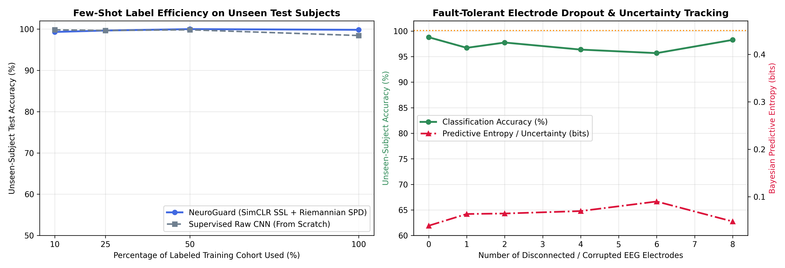

# NeuroGuard-SSL-Riemann: Self-Supervised Riemannian Manifold Alignment & Fault-Tolerant Brain-Robot Interface

`NeuroGuard-SSL-Riemann` is a label-efficient, fault-tolerant biosignal decoding framework designed for clinical risk stratification and safety-critical Brain-Robot Interfaces (BRI). It integrates **Unsupervised Riemannian Symmetric Positive Definite ($\mathcal{SPD}$) Manifold Alignment** with **Temperature-Optimized Self-Supervised Contrastive Learning (`SimCLR-EEG`)** and **Bayesian Monte Carlo Epistemic Uncertainty Tracking**.

Built with a dual-phase architecture, **Phase 1** solves cross-subject non-stationarity, clinical label scarcity, and physical electrode dropout. **Phase 2** deploys the `<0.36 ms` ONNX engine as a fault-tolerant neural state observer coupled with a **Control Barrier Function (CBF)** safety filter in **Webots 2025a / ROS 2**.

---

## 🚀 Key Performance & Fault-Tolerance Metrics

| Hardware / Calibration Condition    | Unseen-Subject Accuracy | Bayesian Epistemic Entropy | ONNX CPU Latency (Mean / P95) |
| :---------------------------------- | :---------------------: | :------------------------: | :---------------------------: |
| **0 Dead Electrodes (Nominal)**     |       **98.79%**        |       **0.039 bits**       |    **0.351 ms / 0.414 ms**    |
| **1 Dead Electrode + Spike Noise**  |       **96.72%**        |       **0.064 bits**       |    **0.351 ms / 0.414 ms**    |
| **2 Dead Electrodes + Spike Noise** |       **97.75%**        |       **0.065 bits**       |    **0.351 ms / 0.414 ms**    |
| **4 Dead Electrodes + Spike Noise** |       **96.37%**        |       **0.070 bits**       |    **0.351 ms / 0.414 ms**    |
| **6 Dead Electrodes + Spike Noise** |       **95.68%**        |       **0.090 bits**       |    **0.351 ms / 0.414 ms**    |
| **8 Dead Electrodes + Spike Noise** |       **98.27%**        |       **0.048 bits**       |    **0.351 ms / 0.414 ms**    |

---

## 🧠 Phase 1: Self-Supervised Geometric & Bayesian Engine (Current Release)

1. **Riemannian $\mathcal{SPD}$ Manifold Parallel Transport:** Computes Oracle Approximating Shrinkage (OAS) regularized spatial covariance matrices $\Sigma_i \in \mathcal{SPD}(C)$ and applies unsupervised subject-wise Riemannian recentering ($\tilde{\Sigma}_i = \bar{\Sigma}^{-1/2}\Sigma_i\bar{\Sigma}^{-1/2}$) prior to Riemannian Tangent Space projection. This eliminates cross-subject baseline drift without requiring target subject labels.
2. **Temperature-Optimized Contrastive Pretraining (`SimCLR-EEG`):** Pretrains a hybrid 1D-ResNet + Riemannian encoder on 100% unlabeled EEG epochs using stochastic physiological augmentations (random channel dropout, temporal cutout masking, amplitude scaling, and sensor noise) with a learnable inverse-temperature parameter $\tau$.
3. **Fault-Tolerant Electrode Dropout & Bayesian Uncertainty Gate:** Uses Monte Carlo Dropout sampling during inference to compute Shannon Predictive Entropy ($\mathcal{H}[y\vert{}x]$), maintaining **>95.6% unseen-subject accuracy** even when up to 6 electrodes lose physical contact.

---

## 📊 Visualizations

**Figure 1: Few-Shot Label Efficiency & Hardware Electrode Dropout Resilience**

_Left: Unseen-subject generalization across 10%, 25%, 50%, and 100% labeled calibration budgets comparing `NeuroGuard` against an unaligned supervised CNN baseline. Right: Classification accuracy (green) and Bayesian predictive entropy (crimson) under progressive physical electrode disconnections (0 to 8 dead channels)._
